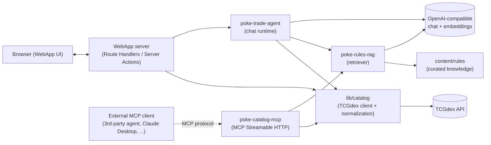

# PokeTrade — Architecture & Design

Extends [brd.md](./brd.md) (product scope) and [tech-spec.md](./tech-spec.md) (stack, dependencies, performance contract). This document does not repeat product behavior or API credential details already covered there.

## 1. Scope

Four logical components, one deployable unit at MVP:

| Component | Role |
| --- | --- |
| **WebApp** | Next.js App Router UI — accounts, collection, want list, trade scratchpad, card/set screens |
| **poke-catalog-mcp** | MCP server exposing card/set/price lookups to any MCP-capable consumer (our agent and external ones) |
| **poke-rules-rag** | Retrieval over curated TCG trade/grading/reprint knowledge, generic + set-specific |
| **poke-trade-agent** | Chat runtime grounding LLM answers in poke-catalog-mcp + poke-rules-rag for Trade Analysis and Set Overview |

## 2. Constraints carried from tech-spec.md / brd.md

- No database — local JSON under `data/` only.
- Minimum dependencies — no vector DB, no message broker, no separate agent framework unless the stack can't do it.
- Latency: soft tip at ~10s, each component ready ≤20s, parallel fetch, stream/render per piece, no silent fallback swap before the wait path completes.
- One provider failure must not take down the whole app.
- Agent must separate catalog facts / assessments / predictions and never present an estimate as a guaranteed price.
- Agent prompts live in version-controlled files, not inline strings.
- Secrets in `.env.local` only.

These constraints drive the decisions below more than any general MLOps default — this is a single-model, hosted-API product, not a trained-model platform. Kubeflow/MLflow-class tooling would be platform overkill here.

## 3. System overview



Key idea: **poke-catalog-mcp is a thin protocol adapter, not where logic lives.** The reusable asset is `lib/catalog` (and `lib/rules` for retrieval). WebApp and poke-trade-agent call those libraries **in-process** — no HTTP hop to our own MCP endpoint. The `/mcp` route exists purely so *external* MCP clients get the same capability over the wire. This avoids self-referential network calls burning latency budget, while still genuinely "exposing the service to other uses" as requested.

## 4. Component design

### 4.1 WebApp

- Next.js 16 App Router. Route groups: `(auth)` for login/register/reset, `(app)` for authenticated collection/want-list/trade/card/set screens.
- Server Components read `lib/catalog` directly for dashboard, search, and details — no client-side waterfall to an internal API.
- Client state: React Query for server-cache data (prices, search results), Zustand for the trade scratchpad draft (local, saved to `data/` on demand), RHF + Zod for all forms (account, add-card, trade draft).
- Chat surfaces (Trade Analysis, Set Overview) are Route Handlers (`app/api/agent/trade/route.ts`, `app/api/agent/set/route.ts`) that stream `poke-trade-agent` output via `ReadableStream`/SSE so tokens render as generated — satisfies "stream each piece as it completes."
- `proxy.ts` (Next 16 renamed `middleware.ts`) handles: session gate on `(app)` routes, and a lightweight in-memory rate limiter on `/mcp` and `/api/agent/*`.

### 4.2 poke-catalog-mcp

- Transport: **MCP Streamable HTTP**, `@modelcontextprotocol/sdk`, stateless mode — matches the existing Pandorium MCP convention already in the stack and works on serverless/Vercel without session affinity.
- Tools exposed:
  - `search_cards(name?, setCode?, number?, language?)`
  - `get_card(cardId)`
  - `get_set(setCode)`
  - `get_price_snapshot(cardId)`
- Implementation: `app/mcp/route.ts` registers tools that call straight into `lib/catalog`. No business logic in the route file itself.
- `lib/catalog` responsibilities:
  - TCGdex client with timeout + retry (per tech-spec pitfalls).
  - Normalize provider payloads into a shared `CardIdentity` / `PriceSnapshot` schema (§5).
  - Aggregate multiple price sources (TCGPlayer USD, Cardmarket EUR) and compute the Green/Yellow/Red price signal.
  - File-based TTL cache: `data/cache/prices/{cardId}.json`, `data/cache/cards/{cardId}.json` — cache hit still carries `lastUpdated`; never relabeled as live.
  - Every call returns a well-formed result even on upstream failure — a typed `{ ok: false, reason, staleData? }` shape, never a thrown error crossing the MCP boundary. This is what makes "one provider failure doesn't take down the app" hold for the agent's tool loop too.

### 4.3 poke-rules-rag

- Two knowledge tiers, matching the BRD's load-generic-at-launch / load-set-specific-on-demand split:
  1. **Generic corpus** — curated Markdown under `content/rules/generic/*.md` (trade practices, grading basics, common pitfalls). Chunked and embedded **offline** by `scripts/build-rag-index.mjs`, committed as `content/rules/index/generic.embeddings.json`. Loaded into memory once at process start — no embedding-API cost or latency at boot.
  2. **Set-specific notes** — fetched/embedded on first access per set, cached at `data/cache/rag/sets/{setCode}.json` with a TTL; a cache miss must not block the Set Overview screen from rendering catalog data (render catalog first, backfill notes when ready — per "stream per piece").
- Retrieval: brute-force cosine similarity in-process. Justified while the corpus stays small (rules/grading knowledge is inherently a few hundred chunks, not a scaling corpus) — this satisfies "no database" and "minimum dependencies" directly instead of reaching for a vector DB. **Revisit only if the corpus exceeds roughly 5,000 chunks or the in-memory index exceeds ~50MB** (see ADR candidate, §8).
- Each retrieved chunk carries source + date so the agent's Chat responses can cite provenance, per BRD Data Quality requirements.

### 4.4 poke-trade-agent

- One runtime, two configurations — not two agents. Trade Analysis and Set Overview differ only in system prompt and injected context (trade draft JSON vs. set summary JSON); the tool loop, tool set, and response schema are identical. Building two separate agent implementations here would be the kind of premature duplication the project's engineering conventions want avoided.
- Prompts are files, not inline strings: `prompts/trade-analysis.system.md`, `prompts/set-overview.system.md` — version-controlled per BRD.
- Tool schema given to the LLM mirrors poke-catalog-mcp's tool list 1:1 (`search_cards`, `get_card`, `get_set`, `get_price_snapshot`) plus `retrieve_rules(query, setCode?)` from poke-rules-rag — but execution calls `lib/catalog` / `lib/rules` directly in-process (§3).
- Model: OpenAI SDK → `gpt-5.4`, `max_completion_tokens` (never `max_tokens`, per tech-spec pitfall). DashScope/Qwen as the documented fallback path where wired.
- Output contract (`AgentAnswer`, §5) forces the fact/assessment/prediction split at the schema level rather than trusting prompt wording alone — the UI renders each bucket distinctly and can't accidentally show a prediction as a guaranteed price even if the model blurs the language.
- Conversation context: trade draft or set stays attached to the conversation thread (in-memory per session on the server, not persisted beyond the scratchpad draft already saved by the WebApp).

## 5. Shared contracts

Defined once in `lib/schemas.ts` (Zod), consumed by `lib/catalog`, `poke-catalog-mcp` tool results, and the WebApp UI — one source of truth for the data-quality fields the BRD requires everywhere (last-updated, source, confidence).

```ts
type Signal = "green" | "yellow" | "red"; // never color-only; always paired with label + description

interface CardIdentity {
  cardId: string; name: string; setCode: string; number: string; language: string;
  rarity?: string; images?: { small?: string; large?: string };
}

interface PriceSnapshot {
  cardId: string;
  sources: Array<{ provider: "tcgplayer" | "cardmarket"; currency: string;
    listPrice?: number; lastSale?: number; avg1?: number; avg7?: number; avg30?: number;
    lastUpdated: string }>;
  priceSignal: { value: Signal; label: string; description: string };
  confidence: number; // 0..1, drives Yellow/Red when data is incomplete or conflicting
}

interface AgentAnswer {
  facts: Array<{ statement: string; source: "catalog" | "rag"; citation: string }>;
  assessment: string;          // fairness / value judgement, explicitly non-authoritative
  predictions?: string[];      // explicitly labeled as predictions, never as guaranteed prices
  tradeFairness?: { value: Signal; label: string; description: string };
  confidence: number;
  lastUpdated: string;
}
```

## 6. Cross-cutting concerns

**Caching.** File-based TTL cache under `data/cache/` for prices, card/set metadata, and set-specific RAG notes. Cache entries always carry `lastUpdated`; a cache hit is never relabeled as a live fetch (tech-spec Fallbacks rule).

**Error handling.** `Promise.allSettled` at every aggregation point (multi-provider price fetch, parallel dashboard card fetches) so one failing source degrades that one field to Yellow/Red instead of failing the whole response. MCP tool results are always well-formed — errors are data, not thrown exceptions, at that boundary.

**Performance.** Dashboard and search fetch cards in parallel and render progressively (Suspense boundaries per card/section) rather than blocking on the slowest one. Chat responses stream token-by-token. Client shows the "more time is needed" tip after ~10s locally; the server timeout (~20s target) is a separate, non-conflicting contract, per tech-spec.

**Observability (MVP-appropriate, not APM overkill).** Structured JSON logs to stdout, tagged by component (`webapp`, `mcp`, `rag`, `agent`) and a request-scoped correlation id threaded from the WebApp request through to catalog/RAG calls, so one trade-analysis request is traceable end to end without standing up a dedicated observability stack. Track per component: latency, cache hit/miss, provider success/failure, confidence distribution. Promote to a real APM/log sink only if/when operating at a scale that justifies it — not before.

**Security.** `(app)` routes and `/api/agent/*` require an authenticated session (session mechanism is an open decision, see §8). `/mcp` is read-only public catalog data (no PII) and only needs the in-memory rate limiter in `proxy.ts` — no auth required at MVP scope since it exposes no user data, only card/price lookups. Secrets stay server-side only, per tech-spec.

## 7. Data & file layout (proposed)

```
app/
  (auth)/...
  (app)/dashboard|collection|want-list|trade|cards/[cardId]|sets/[setCode]/...
  api/agent/trade/route.ts        # streaming chat, Trade Analysis
  api/agent/set/route.ts          # streaming chat, Set Overview
  mcp/route.ts                    # poke-catalog-mcp — thin MCP adapter
  proxy.ts                        # session gate + rate limit (renamed from middleware.ts)
lib/
  catalog/                        # TCGdex client, normalization, price aggregation, cache
  rules/                          # chunker, embedder, retriever, index loader
  agent/                          # tool loop, prompt loader, AgentAnswer schema
  persistence/                    # local JSON read/write for collection, want-list, trade drafts
  schemas.ts                      # CardIdentity / PriceSnapshot / AgentAnswer (§5)
prompts/
  trade-analysis.system.md
  set-overview.system.md
content/rules/
  generic/*.md
  index/generic.embeddings.json   # build artifact, regenerate via scripts/build-rag-index.mjs
data/                              # gitignored, runtime state — no DB
  users/{userId}/collection.json
  users/{userId}/want-list.json
  users/{userId}/trade-drafts/*.json
  cache/prices|cards/{id}.json
  cache/rag/sets/{setCode}.json
scripts/
  build-rag-index.mjs
  smoke.mjs                        # existing
```

## 8. Deployment topology — MVP vs. later split

| | MVP (now) | Phase 2 trigger to split |
| --- | --- | --- |
| Process model | Single Next.js deployment; `/mcp` co-located | External demand for poke-catalog-mcp independent of the web app's release cycle, or its load profile diverging enough to need separate scaling |
| RAG index | Committed JSON embeddings, brute-force cosine | Corpus exceeds ~5,000 chunks / ~50MB in memory → SQLite-vec or a managed vector store |
| Cache | Local JSON files with TTL | Multi-instance horizontal scaling → shared cache (Redis/edge KV) since file cache and the in-memory rate limiter both assume a single instance |
| Rollback | Standard git revert + redeploy (no trained model to version — we call hosted APIs) | N/A unless self-hosting a model later |

This is intentionally a one-tier MVP: no Kubeflow/registry/feature-store machinery, because there's one hosted model and no training pipeline. Revisit only if the product grows a self-hosted or fine-tuned model.

## 9. Decisions worth recording as ADRs

Flagging these for `/retrospective` → `specs/adr/` rather than deciding silently:

1. **MCP server as thin adapter over `lib/catalog`/`lib/rules`, not the home of business logic** — affects where future catalog features get built.
2. **Brute-force in-process RAG retrieval instead of a vector DB**, with the explicit corpus-size trigger to revisit.
3. **Session/auth mechanism for `(app)` routes** — not yet chosen; needs a minimal-dependency pick (e.g. signed cookie + `iron-session`-style approach) rather than pulling in a full auth framework. This blocks implementing the User Account feature and should be decided before that story starts.
4. **One agent runtime, two prompt configurations** for Trade Analysis and Set Overview, instead of two separate agents.

## 10. Open questions

- Session/auth library choice (§9.3) — needed before the User Account story can be implemented.
- Where trade drafts get persisted long-term vs. treated as scratch state (BRD says "save drafts" — confirm whether that means `data/users/{id}/trade-drafts/*.json` survives across devices/sessions or is local-only).
- Confirm DashScope (Qwen) is a true fallback path for chat (per tech-spec `DASHSCOPE_API_KEY`) vs. an alternate primary — affects whether `poke-trade-agent`'s model client needs a provider-switch abstraction now or can wait.
