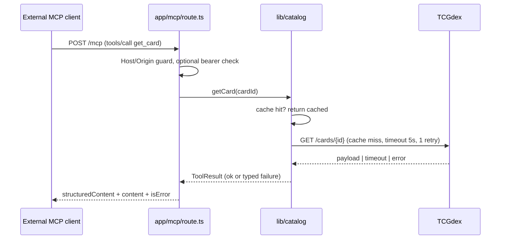

# poke-catalog-mcp — Detailed Technical Design

Implements the MCP component defined in [../architecture-design.md](../architecture-design.md) §4.2. That document set the shape (thin protocol adapter over `lib/catalog`, not where business logic lives); this document makes it buildable: exact package, schemas, algorithms, and file layout.

## 1. Package and SDK version

**`@modelcontextprotocol/server@^2.0.0`** — not the older `@modelcontextprotocol/sdk` package.

The SDK was restructured into scoped packages (`@modelcontextprotocol/server`, `@modelcontextprotocol/node`, `@modelcontextprotocol/client`, framework adapters). `@modelcontextprotocol/sdk` (currently 1.30.0 on npm) is the frozen v1 line; its docs site labels itself legacy and a codemod (`v1-to-v2` — confirm exact command in the SDK's migration guide at build time, since this doc predates that build) migrates off it. Building new on v1 would mean redoing this work within the MVP-1→MVP-4 window. Confirm the installed version's exact API against `https://ts.sdk.modelcontextprotocol.io/v2/` before implementing — the mcp-server-patterns skill's warning that "SDK APIs change between releases" is not hypothetical here; this design was checked against the SDK's `main` branch docs on 2026-07-29.

```bash
npm install @modelcontextprotocol/server zod
```

`zod` is already a project dependency (tech-spec.md) — reuse it, no new validation library.

## 2. Why `createMcpHandler`, not a hand-wired transport

`@modelcontextprotocol/server` exposes `createMcpHandler(factory)`, returning `{ fetch, close }` where `fetch` is a **web-standard `(Request) => Promise<Response>`**. Next.js App Router Route Handlers already speak that exact signature — `export async function POST(request: Request)` can hand the request straight to `handler.fetch` with no Node `req`/`res` adapter (`toNodeHandler`, from `@modelcontextprotocol/node`, exists only for classic Node HTTP servers/Express/Fastify — irrelevant here). This is a genuine, checked fit for the stack, not a guess.

The factory runs once per request and holds no state between calls — the endpoint is stateless and scales horizontally without extra work, matching the "single Next.js deployment, no session affinity" decision in architecture-design.md §4.2.

## 3. Mount point

```
app/mcp/route.ts
```

```ts
// app/mcp/route.ts
import { createMcpHandler, McpServer, hostHeaderValidationResponse, originValidationResponse } from '@modelcontextprotocol/server';
import { registerCatalogTools } from '@/lib/mcp/tools';

const handler = createMcpHandler(() => {
  const server = new McpServer({ name: 'poke-catalog-mcp', version: '0.1.0' });
  registerCatalogTools(server); // wires the 5 tools in §5 to lib/catalog — no logic here
  return server;
});

const ALLOWED_HOSTS = (process.env.MCP_ALLOWED_HOSTS ?? '').split(',').filter(Boolean);

async function guarded(request: Request): Promise<Response> {
  const rejected =
    hostHeaderValidationResponse(request, ALLOWED_HOSTS) ??
    originValidationResponse(request, ALLOWED_HOSTS);
  if (rejected) return rejected;

  const authResult = await checkOptionalBearerAuth(request); // §4.2
  if (authResult instanceof Response) return authResult;

  return handler.fetch(request, { authInfo: authResult });
}

export { guarded as GET, guarded as POST };
```

`hostHeaderValidationResponse`/`originValidationResponse` (from `@modelcontextprotocol/server`) are the SDK's documented DNS-rebinding guard for bare fetch-native runtimes — `createMcpHandler` itself validates neither Host nor Origin, so skipping this step would leave the route open to a malicious page resolving its own origin to the deployment's host. `MCP_ALLOWED_HOSTS` is a new env var (comma-separated), added to the `.env.local` template in tech-spec.md's Environment section.

## 4. Security posture (deliberately lighter than the SDK's OAuth path, and why)

The SDK supports full OAuth resource-server auth (`requireBearerAuth`, protected-resource metadata, per-tool scopes) for servers gating sensitive actions. That's the wrong amount of machinery here: `poke-catalog-mcp` exposes **read-only, non-PII, already-public Pokémon card catalog and price data** — there is no user data, no mutation, nothing an unauthorized caller could do beyond reading what TCGdex itself already serves publicly. Standing up an authorization server for that would be platform overkill for what brd.md explicitly wants exposed to "other uses."

What it does get, layered:

1. **Host/Origin validation** (§3) — always on, stops DNS rebinding regardless of auth.
2. **Optional shared-secret bearer check** — if `MCP_API_KEY` is set, callers must send `Authorization: Bearer <key>`; unset (the MVP default) means open access. This is a manually-written verifier (not the SDK's OAuth `requireBearerAuth`, which expects a real token issuer) — a `checkOptionalBearerAuth(request)` function in `lib/mcp/auth.ts` that does a `crypto.timingSafeEqual` comparison and returns either `undefined` (no key configured — allow), an `AuthInfo`-shaped object (valid key), or a `401 Response` (invalid key). This is the "verify the token yourself, pass the result as `fetch`'s second argument" pattern the SDK's own docs describe for non-OAuth callers.
3. **Rate limiting** — an in-memory token bucket per IP in `proxy.ts` (Next.js 16's renamed `middleware.ts`), matching architecture-design.md §6. Single-instance-only by design (see architecture-design.md §8's Phase 2 trigger for a shared store).

Revisit real OAuth only if a future consumer needs write access or per-client quotas beyond IP-based limiting — track as an ADR candidate, not a day-one requirement.

## 5. Tool catalog

Every tool: a Zod `inputSchema`, a Zod `outputSchema` (validated server-side before the result leaves, and advertised in `tools/list` so external clients can validate too), a `structuredContent` payload matching it, and a human-readable `content` text block for clients that only read that. Descriptions are load-bearing — the model chooses tools by name + description + schema, per mcp-server-patterns.

### 5.1 Shared schemas (`lib/schemas.ts`)

```ts
import { z } from 'zod';

export const Signal = z.enum(['green', 'yellow', 'red']);

export const DataQualityFlag = z.enum(['stale', 'missing', 'conflicting', 'incomplete']);

export const CardIdentity = z.object({
  cardId: z.string(),
  name: z.string(),
  setCode: z.string(),
  number: z.string(),
  language: z.string(),
  rarity: z.string().optional(),
  images: z.object({ small: z.string().url().optional(), large: z.string().url().optional() }).optional(),
});

export const PriceSource = z.object({
  provider: z.enum(['tcgplayer', 'cardmarket']),
  currency: z.string(),
  listPrice: z.number().optional(),
  lastSale: z.number().optional(),
  avg1: z.number().optional(),
  avg7: z.number().optional(),
  avg30: z.number().optional(),
  lastUpdated: z.string().datetime(),
});

export const PriceSnapshot = z.object({
  cardId: z.string(),
  sources: z.array(PriceSource),
  priceSignal: z.object({ value: Signal, label: z.string(), description: z.string() }),
  confidence: z.number().min(0).max(1),
  qualityFlags: z.array(DataQualityFlag),
});

// Every tool result carries this envelope so a failure is data, not a thrown
// exception — the agent's tool loop (agent-design.md §5) must never see an
// unhandled rejection cross this boundary.
export const ToolResult = <T extends z.ZodTypeAny>(dataSchema: T) =>
  z.discriminatedUnion('ok', [
    z.object({ ok: z.literal(true), data: dataSchema }),
    z.object({ ok: z.literal(false), reason: z.enum(['not_found', 'provider_timeout', 'provider_error', 'invalid_input']), message: z.string() }),
  ]);
```

### 5.2 `search_cards`

| | |
| --- | --- |
| Description | "Search the Pokémon TCG catalog by card name, set code, or card number. Returns standardized card identities; empty array if nothing matches." |
| Input | `{ query: string; language?: string; limit?: number }` — `limit` default 20, max 50 |
| Output | `ToolResult(z.array(CardIdentity))` |
| Backing call | `lib/catalog/search.ts → searchCards()` |

### 5.3 `get_card`

| | |
| --- | --- |
| Description | "Get full catalog details and current price snapshot for one card by its catalog ID." |
| Input | `{ cardId: string }` |
| Output | `ToolResult(z.object({ identity: CardIdentity, price: PriceSnapshot }))` |
| Backing call | `lib/catalog/card.ts → getCard()` |

### 5.4 `get_set`

| | |
| --- | --- |
| Description | "Get a set's identity (name, code, total card count, release info)." |
| Input | `{ setCode: string }` |
| Output | `ToolResult(z.object({ setCode: z.string(), name: z.string(), cardCount: z.number(), releaseDate: z.string().optional() }))` |
| Backing call | `lib/catalog/set.ts → getSet()` |

### 5.5 `list_set_cards` (backs SET-02)

| | |
| --- | --- |
| Description | "List every card in a set with a flag for whether current price data is available, paginated. Use for owned-vs-missing and price-coverage calculations — do not call get_card in a loop for a whole set." |
| Input | `{ setCode: string; cursor?: string; pageSize?: number }` — `pageSize` default 50, max 100 |
| Output | `ToolResult(z.object({ cards: z.array(CardIdentity.extend({ hasPriceData: z.boolean() })), nextCursor: z.string().nullable() }))` |
| Backing call | `lib/catalog/set.ts → listSetCards()` |

The description explicitly steers the model away from an N+1 pattern (`get_card` per card) — a real failure mode for tool-calling models with a large set, and directly enforces tech-spec's "avoid unnecessary repeated API/MCP/RAG/LLM calls."

### 5.6 `get_price_snapshot`

| | |
| --- | --- |
| Description | "Get the current price snapshot (list price, last sale, trailing averages, price signal, sources, confidence) for one card." |
| Input | `{ cardId: string }` |
| Output | `ToolResult(PriceSnapshot)` |
| Backing call | `lib/catalog/price.ts → getPriceSnapshot()` |

Separate from `get_card` because the agent frequently needs *only* a fresh price re-check (e.g., mid trade-analysis) without re-fetching full catalog metadata it already has in context — keeps context small per agent-design.md's "context is precious" principle.

## 6. `lib/catalog` module (the actual logic; the MCP route is a shell over this)

```
lib/catalog/
  client.ts       — TCGdex HTTP client: fetch wrapper, timeout (5s), retry (1 retry, exponential backoff)
  normalize.ts     — raw TCGdex payload -> CardIdentity / PriceSource
  aggregate.ts     — merge TCGPlayer + Cardmarket sources into one PriceSnapshot
  priceSignal.ts   — Green/Yellow/Red classification (§7)
  confidence.ts    — 0..1 confidence score (§7)
  cache.ts         — file-based TTL cache (§8), shared by all the above
  search.ts, card.ts, set.ts, price.ts — the four public functions the tools call
```

## 7. Concrete algorithms

**Price signal** (`priceSignal.ts`), given a card's aggregated sources:

1. If no source has a usable price → **Red**, label "No price", description "No provider has current pricing."
2. Else compute `deviation = |listPrice − avg7| / avg7` (fall back to `avg30` if `avg7` missing).
   - `deviation ≤ 0.10` → **Green**, "Stable", "Close to the 7-day average."
   - `0.10 < deviation ≤ 0.30`, **or** only one provider reports a price → **Yellow**, "Volatile or incomplete data".
   - `deviation > 0.30`, **or** TCGPlayer and Cardmarket (currency-normalized) disagree by more than 25% → **Red**, "Outlier / unreliable / conflicting sources".

These thresholds are a starting point, not derived from real market data yet — flag as tunable, revisit once real TCGdex data is flowing (an explicit "TODO: calibrate against real price history" rather than a silently-invented constant).

**Confidence** (`confidence.ts`): starts at `1.0`, then:
- `-0.3` if only one price source available (of the two possible).
- `-0.2` if the most recent price snapshot is older than 24h.
- `-0.2` per active `qualityFlags` entry (`stale`, `missing`, `conflicting`, `incomplete`), capped so confidence never goes below `0`.

**Data quality flags** (`aggregate.ts`): `missing` (no price at all), `stale` (>24h old and no fresher data available), `conflicting` (cross-provider deviation >25% after currency normalization), `incomplete` (missing avg7/avg30 trend data). More than one flag can be active at once — return all that apply, don't pick the "worst" one silently.

## 8. Caching

File-based TTL cache under `data/cache/` (gitignored), matching architecture-design.md §6/§7.

| Cache | Path | TTL | On upstream failure |
| --- | --- | --- | --- |
| Card/set metadata | `data/cache/cards/{cardId}.json`, `data/cache/sets/{setCode}.json` | 24h | Serve stale with `stale: true` in the response, never block |
| Price snapshot | `data/cache/prices/{cardId}.json` | 15 min | Serve stale (flagged) if within 24h; otherwise return `missing` |
| Set card listing | `data/cache/sets/{setCode}/cards.json` | 6h | Serve stale, flagged |

Every cache entry stores `{ data, fetchedAt }`; the `lastUpdated` field returned to callers is always `fetchedAt`, never "now" — this is what makes DQ-01/PERF-03's "never relabel cached prices as live" enforceable in code, not just policy.

## 9. Error handling

Tool handlers never `throw` for expected failure modes (not-found, provider timeout, provider error). They catch at the `lib/catalog/*.ts` boundary and return the `ToolResult` discriminated union from §5.1; the tool handler wraps that as:

```ts
async ({ cardId }) => {
  const result = await getCard(cardId);
  return {
    content: [{ type: 'text', text: result.ok ? `Found ${result.data.identity.name}` : `Not found: ${result.reason}` }],
    structuredContent: result,
    isError: !result.ok,
  };
}
```

`isError: true` on an ordinary (schema-valid) result is the SDK's documented way to let the model read a failure and adapt, without tearing down the connection — matching mcp-server-patterns' "structured, model-safe messages, no stack traces."

## 10. Testing (common-test-strategy applied)

- **Unit (critical path, 100%)**: `priceSignal.ts`, `confidence.ts`, `normalize.ts`'s provider-payload mapping — pure functions, table-driven tests over the threshold boundaries in §7.
- **Integration**: `lib/catalog/*` against recorded TCGdex fixture responses (success, 404, timeout, malformed payload) — never live TCGdex in CI by default, per common-test-strategy's "fixtures/sandboxes in default CI."
- **Contract**: an in-process MCP `Client` (the SDK ships one for exactly this — see `docs/testing.md`) driving `handler.fetch` directly, asserting `tools/list` matches §5's schemas and that each tool's `structuredContent` validates against its own `outputSchema`.
- **Security regression**: a request with a spoofed `Host`/`Origin` gets `403`; a request with a wrong `MCP_API_KEY` (when set) gets `401`.

## 11. Sequence — external MCP consumer vs. in-process caller



The WebApp and poke-trade-agent skip the HTTP hop entirely — they `import { getCard } from '@/lib/catalog/card'` directly, per architecture-design.md §3's "thin adapter" decision. Only genuine external consumers pay the MCP protocol tax.

## 12. Open questions

- Real threshold calibration for `priceSignal.ts` (§7) once live TCGdex data is available — current values are placeholders, not derived.
- Whether `MCP_ALLOWED_HOSTS` needs to include preview/staging deployment hostnames once a hosting choice is made (not yet decided anywhere in the specs).
