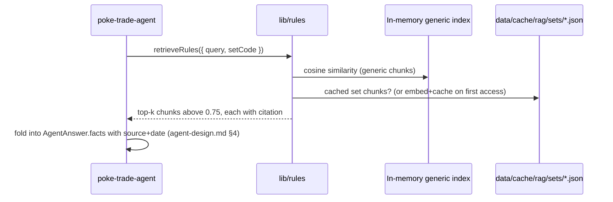

# poke-rules-rag — Detailed Technical Design

Implements the RAG component defined in [../architecture-design.md](../architecture-design.md) §4.3. That document set the shape (two knowledge tiers, brute-force in-process retrieval, no vector DB); this document makes it buildable.

## 1. Why no vector database (explicit, not a default)

The rag-implementation skill's standard toolkit — Pinecone, Weaviate, Milvus, Chroma, Qdrant, pgvector — assumes a corpus large enough that brute-force similarity search is too slow or the deployment already has a database to extend. Neither is true here:

- tech-spec.md is explicit: **no database**, local JSON under `data/` only, minimum dependencies.
- The corpus is inherently small: generic trade/grading/reprint knowledge is a few hundred chunks at most; per-set notes add maybe a few dozen chunks each, only for sets a user actually opens. Brute-force cosine similarity over a few thousand vectors in memory is sub-millisecond — there is no latency problem a vector DB would be solving here.

**Revisit trigger** (also stated in architecture-design.md §8): if the generic corpus exceeds ~5,000 chunks or the in-memory index exceeds ~50MB, move to `sqlite-vec` (still no external service, still fits "no database" if read as "no server-hosted database") or a managed vector store. Not before — that would be exactly the "platform overkill for an MVP" anti-pattern.

## 2. Embedding model

**OpenAI `text-embedding-3-small`** (1536 dimensions), called via the same `openai` SDK and `OPENAI_API_KEY` already configured for chat (tech-spec.md) — no second provider integration just for embeddings. Confirm the exact current model identifier against OpenAI's docs at implementation time; naming/availability can change between when this is written and when it's built.

DashScope is tech-spec's documented fallback chat path but isn't wired here: introducing a second embedding provider (with its own dimension count, meaning the two providers' vectors are never comparable) for an MVP with one small corpus would be added complexity without a corresponding need. If DashScope becomes the primary chat provider, re-embedding the whole corpus with its embedding model is a same-size job either way — track as a follow-up, not a blocker.

## 3. Two knowledge tiers

### 3.1 Generic tier — built offline, loaded at boot

```
content/rules/generic/*.md              — source documents, hand-curated, committed
scripts/build-rag-index.mjs             — offline build: chunk + embed + write index
content/rules/index/generic.embeddings.json  — build artifact, committed
```

The index is built **offline**, not at request time or even at server boot — embedding the generic corpus on every cold start would cost real money and latency for content that changes rarely. `build-rag-index.mjs` runs manually (or in CI, gated on a change to `content/rules/generic/**`) and its output is committed like any other generated-but-checked-in artifact (comparable to a lockfile).

Index schema:

```ts
interface RagIndex {
  model: string;           // e.g. "text-embedding-3-small" — mismatch guard, see §6
  builtAt: string;         // ISO timestamp
  chunks: Array<{
    id: string;             // `${sourceFile}#${chunkIndex}`
    text: string;
    sourceFile: string;
    heading: string | null; // nearest markdown heading, for citation
    citation: { source: string; date: string | null };
    embedding: number[];
  }>;
}
```

At process start, `lib/rules/index.ts` reads this file once into memory (`RagIndex`) and keeps it there for the process lifetime — no re-read per request.

### 3.2 Set-specific tier — on-demand, cached

```
content/rules/sets/{setCode}.md         — curated, hand-written per set (see §3.3)
data/cache/rag/sets/{setCode}.json      — embedded + cached on first access, gitignored
```

Triggered the first time a collector opens Set Overview for that set (SET-01/RAG-02). Retrieval flow:

1. Check `data/cache/rag/sets/{setCode}.json`. If present and not expired (30-day TTL — set lore doesn't change often), use it.
2. Else, check `content/rules/sets/{setCode}.md` exists. If not, return an empty result for this tier — **do not fabricate set-specific commentary**. The Set Overview screen still renders fully from catalog data (SET-01/SET-02); it's simply not RAG-grounded for set-specific trivia yet. This is the graceful-degradation path RAG-02 requires ("must not block the screen").
3. Else, chunk + embed that file, write the cache entry, return the chunks.
4. Concurrent requests for the same uncached set share one in-flight embedding call — a `Map<string, Promise<Chunk[]>>` keyed by `setCode` in `lib/rules/setNotes.ts`, cleared once the promise settles. Without this, two collectors opening the same new set at once would each pay for and race to write the embedding.

### 3.3 Where set-specific content comes from (an ops question, not a code one)

`content/rules/sets/*.md` are **hand-curated markdown files**, not LLM-generated. RAG-03 requires every knowledge item to carry a source and date where available — an ungrounded LLM summary wouldn't have one, and would contradict DQ-03's "AI judgments must not be presented as authoritative." Authoring cadence (who writes these, how often, for which sets) is a content-ops process to define separately — flagged here as an open question, not solved by code.

## 4. Chunking

A small hand-rolled chunker (`lib/rules/chunk.ts`) — not a dependency like `langchain`'s text splitters, consistent with minimum-dependencies. Given the corpus is curated markdown (not arbitrary scraped text), a heading-aware splitter is simpler and better-fitted than a generic recursive character splitter:

1. Split each source file on markdown headings (`##`, `###`) — each section becomes a candidate chunk, tagged with its nearest heading for `heading`/citation purposes.
2. If a section exceeds ~500 tokens, recursively split on paragraph boundaries (blank lines), then sentence boundaries, with ~50-token overlap between adjacent pieces — standard overlap-for-context-continuity practice, sized small because these sections are already topically narrow (grading basics, one reprint note, etc.), not a full article.
3. Discard chunks under ~20 tokens (heading-only fragments with no body text).

## 5. Retrieval

```ts
interface RetrievedChunk {
  text: string;
  citation: { source: string; date: string | null };
  score: number; // cosine similarity, 0..1
}

async function retrieveRules(params: {
  query: string;
  setCode?: string;
  k?: number; // default 5
}): Promise<{ chunks: RetrievedChunk[]; usedSetSpecific: boolean }>
```

Algorithm: embed `query` (one OpenAI call), brute-force cosine similarity against the generic index plus the set-specific chunks (if `setCode` given and available per §3.2), sort descending, take top `k`. **Minimum-similarity floor of 0.75** — below that, a chunk is more likely noise than relevant grounding, and returning it would let the agent cite something tenuously connected to the question. If nothing clears the floor, return an empty array; the agent must treat that as "no specific guidance found," not silently drop the caveat.

Explicitly **not built** for MVP-2 (the first consumer of this retriever, per stories.md AGENT-01): reranking (cross-encoder or LLM-based), hybrid BM25+dense fusion, MMR diversity selection. All are rag-implementation-skill-standard techniques for corpora and query loads this product doesn't have — a few hundred curated chunks don't need a reranker to surface the right one. Revisit only if retrieval quality complaints actually show up once real usage exists.

## 6. Model/version consistency guard

`RagIndex.model` is checked against the embedding model the retriever is configured to call at startup. A mismatch (e.g., the committed index was built with a different model than the running code expects) throws at boot with a clear message — comparing embeddings from two different models silently would return meaningless similarity scores with no error, the worst failure mode for this kind of system.

## 7. Testing (common-test-strategy applied)

- **Unit (critical path, 100%)**: cosine similarity math, the chunker's boundary behavior (heading-only fragments dropped, overlap applied correctly, token-count estimation), the minimum-similarity floor.
- **Integration**: `retrieveRules()` against a small fixture index (5–10 known chunks with known embeddings, hand-verified expected top-k for a handful of test queries) — deterministic, no real OpenAI calls in default CI.
- **Set-specific path**: cache-hit / cache-miss-with-file / cache-miss-without-file (graceful empty result) / concurrent-request-dedup, each as its own test.
- **Model-mismatch guard**: a fixture index with a wrong `model` value must fail startup with a clear error, not silently serve garbage scores.

## 8. Build script outline (`scripts/build-rag-index.mjs`)

```js
// 1. Glob content/rules/generic/**/*.md
// 2. For each file: chunk (lib/rules/chunk.ts, imported via a shared TS/JS boundary
//    or reimplemented as plain JS here — decide at implementation time based on
//    whether the project's tooling supports importing TS from a .mjs script directly)
// 3. Batch chunks into groups of ~100 for the OpenAI embeddings API (rate/cost sensible batch size)
// 4. Write content/rules/index/generic.embeddings.json with { model, builtAt, chunks }
// 5. Print a summary (chunk count, file count, estimated index size) so a reviewer
//    can sanity-check the diff in a PR — an index that suddenly doubles in size
//    or drops most chunks is a signal worth a human look before merging.
```

## 9. Sequence — Trade Analysis chat grounding a claim



## 10. Open questions

- Content-authoring process for `content/rules/generic/*.md` and `content/rules/sets/*.md` — who writes/reviews these, and how often (§3.3).
- Whether DashScope becomes primary enough to justify a second embedding pipeline (§2).
- Real relevance tuning of the 0.75 similarity floor and `k=5` once there's real usage to observe (currently reasoned defaults, not measured ones).
